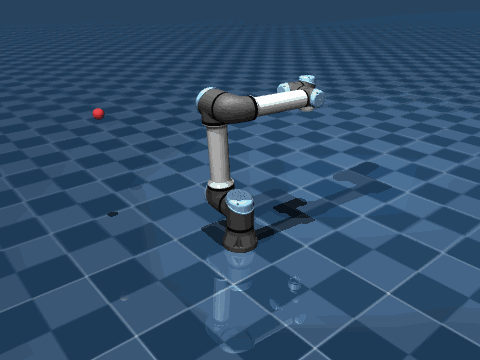

# robot_rl_vla



*A reinforcement-learning policy (SAC) driving a simulated UR5e arm to random target points (red) in MuJoCo.
Each target has to be reached within 2 cm and held there before the next one appears.*

The goal of this project is a simulated robot arm that goes to any point it's asked to. I built it up in layers:
first classical kinematics and control on top of MuJoCo, then a reinforcement-learning policy trained to do the
same job, benchmarked against the classical solver. Simulation and software only.

## What's in here

### Kinematics and control (`kinematics/`, `control/`)

- **Forward kinematics** with `mj_kinematics`: end-effector pose for any joint configuration, plus workspace
  sampling and a 3-D plot of the reachable workspace.
- **Jacobians** with `mj_jacSite`, and a sweep of the Jacobian's condition number to show where the arm becomes
  singular.
- **Inverse kinematics** on MuJoCo's Jacobian: pseudo-inverse and damped least squares (DLS) for position, and
  full-pose IK (position + orientation, error via `mju_subQuat`) with random restarts. Type `x y z` in the terminal
  and the arm goes there.
- **Trajectories and torque control:** minimum-jerk joint trajectories tracked by a PD controller with gravity
  compensation (`qfrc_bias`), on a version of the UR5e with its actuators switched to torque motors.

### Reinforcement learning (`rl/`)

- **`reach_env.py`, a Gymnasium environment.** Each episode samples a target the arm can reach without touching the
  floor or itself. The policy sees joint angles and velocities, hand and target positions and its previous action
  (27 numbers), and outputs a change to the six joint position targets (at most 0.025 rad per 0.02 s step).
  The reward combines:
  - distance to the target, with an exponential term that pulls hard in the last few centimetres;
  - penalties on action size and on **changes in action** between steps, for smooth motion;
  - success only after the hand **holds** within 2 cm for 10 steps, so hovering or oscillating through the target
    doesn't count.
- **`train_sac.py`:** Soft Actor-Critic from Stable-Baselines3 on 4 parallel environments, with observation
  normalisation (`VecNormalize`), periodic evaluation on unseen targets, TensorBoard logging, and a **curriculum**
  callback that tightens the success tolerance from 5 cm to 2 cm as the rolling success rate passes 80%.
- **`benchmark.py`:** runs the IK solver (wrapped as a policy with the same speed limit), the trained SAC policy and a
  random baseline on the same 200 targets.
- **`eval_policy.py`** scores and renders a trained policy; **`record_demo.py`** made the GIF above.

## Results

SAC (500k training steps) against damped-least-squares IK, 200 identical targets:

| | success | final distance | steps to reach | path length / straight line | joint speed |
|---|---|---|---|---|---|
| random | 0% | 72.8 cm | – | – | 0.37 rad/s |
| IK | **86.5%** | 2.2 cm | 79 | 1.14 | 0.97 rad/s |
| SAC | 73.0% | 2.2 cm | 82 | 1.16 | 1.14 rad/s |

- IK is the stronger controller overall. It has the exact model; SAC learned only from trial and error.
- **SAC reaches 11 targets that IK can't.** IK only knows geometry, so it sometimes picks a joint solution that runs
  the arm into the floor or into itself; SAC appears to have learned configurations that avoid it. It also does
  better than IK on far-out targets (67% vs 55%) and low targets (69% vs 56%).
- **IK wins close to the base and up high** (91% and 97% against SAC's 71% and 79%). Most of SAC's misses (28 of 38)
  end 2 to 5 cm from the target: it arrives but doesn't settle within 2 cm.
- Paths are about equally direct; SAC still moves its joints more than IK for the same result.
- I also tried an approach-direction penalty (come in outwards from the base, never from beyond the target). SAC's
  overshoot stayed the same as IK's, which doesn't try at all, so it's switched off (`overshoot_weight=0`).

## Next steps

- Close the precision gap: more training at the final 2 cm tolerance and a stronger reward for holding still.
- **Vision-language-action.** Replace the typed target with language and vision: a VLM that turns
  "go to the red cube" and a camera image into a 3-D target for the controllers here, and then an end-to-end VLA
  policy that maps images and instructions straight to joint actions.

## Setup

```bash
pip install -r requirements.txt
git clone https://github.com/google-deepmind/mujoco_menagerie.git   # robot models (not tracked here)
```

Run everything from the repo root:

```bash
python kinematics/go_to_point.py                    # type x y z, the arm goes there (IK)
python control/go_smooth.py                         # same, with min-jerk trajectories and torque control
python rl/train_sac.py --steps 500000 --name my_run # train; watch with: tensorboard --logdir runs
python rl/eval_policy.py --model checkpoints/my_run/final.zip --render
python rl/benchmark.py --model checkpoints/my_run/final.zip --episodes 200
```

## Layout

```
kinematics/   forward kinematics, Jacobians, IK, interactive demos and plots
control/      min-jerk trajectories, PD + gravity-compensation torque control
rl/           Gymnasium reach environment, SAC training, evaluation, IK benchmark, demo recording
media/        demo GIF
```
