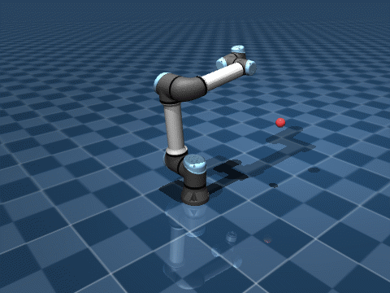

# robot_rl_vla



*The final reinforcement-learning policy (SAC) driving a simulated UR5e arm to target points (red) in MuJoCo. Each
target has to be reached within 2 cm and held for 0.2 s before the next one appears. Highlight reel: each target is
the fastest-held of 12 random candidates (`rl/record_demo.py --best-of 12`); typical performance is in Results.*

The goal of this project is a simulated robot arm that goes to any point it's asked to. I built it up in layers:
first classical kinematics and control on top of MuJoCo, then a reinforcement-learning policy trained to do the
same job, benchmarked against the classical solver. Simulation and software only.

## What's in here

### Kinematics and control (`kinematics/`, `control/`)

- **Forward kinematics** with `mj_kinematics`: end-effector pose for any joint configuration, plus workspace
  sampling and a 3-D plot of the reachable workspace.
- **Jacobians** with `mj_jacSite`, and a sweep of the Jacobian's condition number to show where the arm becomes
  singular.
- **Inverse kinematics** on MuJoCo's Jacobian: pseudo-inverse and damped least squares (DLS) for position, and
  full-pose IK (position + orientation, error via `mju_subQuat`) with random restarts. Type `x y z` in the terminal
  and the arm goes there.
- **Trajectories and torque control:** minimum-jerk joint trajectories tracked by a PD controller with gravity
  compensation (`qfrc_bias`), on a version of the UR5e with its actuators switched to torque motors.

### Reinforcement learning (`rl/`)

- **`reach_env.py`, a Gymnasium environment.** Each episode samples a target the arm can reach without touching the
  floor or itself. The policy sees joint angles and velocities, hand and target positions and its previous action
  (27 numbers), and outputs a change to the six joint position targets (at most 0.025 rad per 0.02 s step).
  The final reward is deliberately simple: distance to the target, an exponential term that pulls hard in the last
  few centimetres, a small penalty on action size, and success only after the hand **holds** within 2 cm for 10
  steps. The other terms I tried are still in the code with their weights set to 0 (see Results).
- **`train_sac.py`:** Soft Actor-Critic from Stable-Baselines3 on 4 parallel environments, with observation
  normalisation (`VecNormalize`), periodic evaluation on unseen targets, TensorBoard logging, and a **curriculum**
  callback that tightens the success tolerance from 5 cm to 2 cm as the rolling success rate passes 80%.
- **`benchmark.py`:** runs the IK solver (wrapped as a policy with the same speed limit), the trained SAC policy and a
  random baseline on the same 200 targets.
- **`eval_policy.py`** scores and renders a trained policy; **`record_demo.py`** made the GIF above.

## Results

All numbers below come from `benchmark.py`: every controller runs on the **same 200 random targets** (collision-free,
unseen in training), with the same speed limit. Success means the hand reached the target within 2 cm **and held it
there for 10 steps** (0.2 s).

### Reward experiments: what I tried, why, and what happened

Each run below trained SAC for 500k steps. I changed the reward to fix something I saw when watching the policy, then
measured whether it actually helped.

| run | what changed, and why | success (held) | success (touch once) | joint speed |
|---|---|---|---|---|
| IK baseline | damped least squares on MuJoCo's Jacobian | **86.5%** | **87.5%** | 0.97 rad/s |
| 1. outward | an **approach-direction penalty**: the arm sometimes swept *through* the target from the far side, so overshooting the target (measured outwards from the base) cost reward | 80.0% | 82.5% | 1.14 rad/s |
| 2. curriculum | the policy often stopped just outside the 2 cm ball, so a **curriculum** starts at 5 cm and tightens to 2 cm as the success rate passes 80% | 78.5% | 82.5% | 1.11 rad/s |
| 3. + hold + action rate | it jittered around the target, so success now required **holding** for 10 steps, and an **action-rate penalty** punished changing the command from one step to the next | 73.0% | 83.0% | 1.14 rad/s |
| 4. final | the same, with the **action-rate penalty off** and the approach penalty off | **80.0%** | 81.5% | 1.21 rad/s |

What the numbers say:

- **No reward change made SAC better at reaching.** Every version touches 81.5–83% of targets; the differences are
  within the ±3% noise of a 200-target test.
- **The action-rate penalty was the expensive one.** It's the only change that hurt: with it, the policy touches as
  many targets but holds far fewer (83% → 73%). Without it (run 4), holding recovers to 80%.
- **Training with the hold didn't teach holding.** Runs 1 and 2 never saw the hold rule and still hold 78.5–80%, the
  same as run 4. What the hold *did* change is the honesty of the metric: a pass through the target no longer counts.
- **The approach-direction penalty didn't change the approach.** SAC's average overshoot stayed level with IK's, which
  makes no attempt to approach from the base side, so the final version leaves it off.
- **No reward term made SAC move as economically as IK.** Its joints move about 15–25% faster for the same result.

The simplest reward did as well as the elaborate ones.

### Final policy against IK, target by target

| | IK reaches | IK misses |
|---|---|---|
| **SAC reaches** | 147 | 13 |
| **SAC misses** | 26 | 14 |

- **SAC reaches 13 targets that IK can't.** IK only knows geometry, so it sometimes picks a joint solution that runs
  the arm into the floor or into itself; SAC appears to have learned arm configurations that avoid that. It does best
  relative to IK on **far-out targets** (70% vs 55%), where the stretched arm likely sags under gravity and IK, aiming
  exactly at the target, settles just short of it.
- **IK wins close to the base, up high and very low** (91%, 97% and 56% against SAC's 80%, 86% and 38%). Most of
  SAC's misses (21 of 26) end 2–5 cm away: it arrives but doesn't settle inside 2 cm.
- 14 targets defeat both.

## Next steps

- Close the precision gap: SAC's misses are near misses, which points to a fine-positioning controller for the last
  few centimetres rather than more reward terms.
- **Vision-language-action.** Replace the typed target with language and vision: a VLM that turns
  "go to the red cube" and a camera image into a 3-D target for the controllers here, and then an end-to-end VLA
  policy that maps images and instructions straight to joint actions.

## Setup

```bash
# Python 3.10+
pip install -r requirements.txt
git clone https://github.com/google-deepmind/mujoco_menagerie.git   # robot models (not tracked here)
```

Run everything from the repo root:

```bash
python kinematics/go_to_point.py                    # type x y z, the arm goes there (IK)
python control/go_smooth.py                         # same, with min-jerk trajectories and torque control
python rl/train_sac.py --steps 500000 --name my_run # train; watch with: tensorboard --logdir runs
python rl/eval_policy.py --model checkpoints/my_run/final.zip --render
python rl/benchmark.py --model checkpoints/my_run/final.zip --episodes 200
```

## Layout

```
kinematics/   forward kinematics, Jacobians, IK, interactive demos and plots
control/      min-jerk trajectories, PD + gravity-compensation torque control
rl/           Gymnasium reach environment, SAC training, evaluation, IK benchmark, demo recording
media/        demo GIF
```
